# BranchFlow – Agentic AI-Powered Student Organization Management System

> **BranchFlow** is an enterprise-grade agentic workflow platform tailored for college clubs, IEEE Student Branches, ACM chapters, hackathon organizing committees, and campus societies.

Instead of manual spreadsheet tracking, chaotic WhatsApp message threads, and scattered Google Docs, organizers simply describe an event in plain English. Autonomous **LangGraph AI agents** extract requirements, build phased timelines, balance volunteer workloads based on skills, draft official institutional proposals, and continuously audit database milestones — with a non-negotiable **Human-in-the-Loop** approval gate.

---

## 🌟 Core Highlights & Architectural Distinctions

- **True Agentic AI Workflow**: Built with **LangGraph** state machines rather than a basic conversational chatbot. Agents coordinate state, call tools, query the database, and pause at approval checkpoints.
- **Human-in-the-Loop Safety**: AI agents never automatically commit changes or assign volunteers without organizer review and approval.
- **Volunteer Workload Balancer**: Heuristic and skill-based matching that scores fitness while actively preventing burnout by flagging overloaded core leads.
- **Official Documentation Hub**: Automatically drafts institutional permission letters for Deans, corporate sponsorship decks, itemized budgets, and post-event IEEE impact reports in rich Markdown.
- **Multi-Tone Broadcast Engine**: Generates channel-optimized copy for WhatsApp, Discord, Email, and Instagram in Professional, Friendly, or Casual tones.
- **Real-Time Database Progress Auditor**: Interrogates live SQLite task tables to detect overdue deadlines and scheduling clashes.
- **Graceful Offline / Demo AI Engine**: If a Google Gemini API key is not supplied, BranchFlow falls back to an intelligent heuristic simulator, ensuring the entire application works out of the box.

---

## 🏗️ System Architecture

```mermaid
flowchart TD
    subgraph UI ["Modern React Frontend (Vite + Tailwind CSS)"]
        LP["Landing Page"]
        DASH["Executive Dashboard"]
        AGENT_WS["AI Agent Command Center"]
        VOL_MGT["Volunteer Workload Balancer"]
        TASK_KAN["Task Kanban & Overdue Alerts"]
        DOCS["Documentation Studio"]
        COMM["Multi-Tone Broadcasts"]
        CONF["Settings & Key Config"]
    end

    subgraph API ["FastAPI Backend (Python 3.12)"]
        ROUTER["REST API Routers"]
        
        subgraph Graph ["LangGraph Agent State Machine"]
            N1["Node 1: Event Planning Agent"]
            N2["Node 2: Volunteer Management Agent"]
            N3["Node 3: Documentation Agent"]
            N4["Node 4: Human-in-the-Loop Checkpoint"]
            N5["Node 5: Atomic DB Persistence"]
        end
        
        LLM_LAYER["Google Gemini API (gemini-1.5-flash) / Heuristic Simulator"]
        AUDIT["Execution Logger & Tracing"]
        N8N["n8n Webhook Dispatcher"]
    end

    subgraph DB ["Persistence Layer"]
        SQLITE[(SQLite Database - SQLAlchemy 2.0)]
    end

    UI <-->|REST APIs / JSON| ROUTER
    ROUTER --> Graph
    Graph <--> LLM_LAYER
    Graph <--> SQLITE
    Graph --> AUDIT
    Graph --> N8N
```



---

## 🛠️ Technology Stack

| Component | Technology | Description |
|---|---|---|
| **Frontend** | React 18, Vite 5 | Fast, responsive single-page application |
| **Styling** | Tailwind CSS | Modern palette (Navy `#0f172a`, White, Soft Lavender `#ede9fe`) |
| **Icons & Charts** | Lucide React, Recharts | Interactive dashboards, KPI cards, and donut/bar charts |
| **Backend** | Python 3.12, FastAPI | High-performance async REST API framework |
| **Agent Framework** | LangGraph, LangChain Core | State machine coordination, tool calling, and human gates |
| **AI Model** | Google Gemini API | `gemini-1.5-flash` with structured JSON output |
| **Database** | SQLite + SQLAlchemy 2.0 | Complete relational schema with relationships & timestamps |
| **Automation** | n8n Webhook Integration | Optional dispatcher for external event automation |

---

## 🤖 The Five Autonomous Agents

### 1. AI Event Planner Agent
- **Role**: Requirement Extraction & Phased Schedule Builder
- **Capability**: Analyzes raw natural language prompts (e.g. *"Organize a two-day AI workshop for 100 students with 10 volunteers and budget of ₹15,000"*).
- **Outputs**: Official event metadata, duration, estimated budget, headcount, venue, multi-day timeline, organizing teams, and initial milestone checklist.

### 2. AI Volunteer Management Agent & Workload Balancer
- **Role**: Skill-Matching & Burnout Prevention Guard
- **Capability**: Evaluates volunteer department, year, ratings, active task loads, and skill tags.
- **Rule**: Imbalance detection warns when core leads carry $\ge$ max task capacity while others are underutilized. Prepares non-destructive recommendations that require human approval.

### 3. AI Documentation Agent
- **Role**: Institutional & Corporate Documentation Specialist
- **Capability**: Generates 7 formal document formats:
  - Official Event Proposals
  - Dean / Principal Permission Letters
  - Sponsorship Pitch Decks & Tier Packages
  - Itemized Financial Budget Drafts
  - All-Hands Meeting Agendas
  - Formal Event Reports
  - Post-Event Summaries for NAAC/IEEE
- **Features**: Live Markdown editor, instant preview, copy-to-clipboard, and `.md` file download.

### 4. AI Communication Agent
- **Role**: Multi-Tone Cross-Channel Copywriter
- **Channels**: WhatsApp (formatted with `*bold*`), Email (subject lines & sign-offs), Instagram (hooks & hashtags), Discord (`@everyone` notices), LinkedIn, and SMS.
- **Tones**: **Professional** (formal, polite), **Friendly** (warm, community-centric), and **Casual / Hype** (high-energy, emojis).

### 5. AI Progress Monitoring Agent
- **Role**: Real-Time Database Milestone Auditor
- **Capability**: Queries real SQLite records rather than fabricated states. Compares task due dates against current system timestamps, flags overdue tasks, identifies volunteer schedule clashes, and prescribes actionable organizer next steps.

---

## 🚀 Quick Start Guide

### Prerequisites
- **Python**: 3.10+ (tested on Python 3.12)
- **Node.js**: v18+ (tested on Node v22)
- **Git**

---

### Step 1: Clone & Setup Backend

```bash
# Navigate to the backend directory
cd backend

# (Optional) Create and activate a virtual environment
python -m venv venv
# On Windows:
.\venv\Scripts\activate
# On Linux/macOS:
source venv/bin/activate

# Install backend dependencies
pip install -r requirements.txt

# Copy environment example
cp .env.example .env
```

*(Optional)* Add your free Google Gemini API key to `.env`:
```env
GEMINI_API_KEY=AIzaSy...
```
> If left empty, BranchFlow automatically activates its built-in heuristic demo engine!

**Run Backend Server:**
```bash
python run.py
```
- API will start on: `http://127.0.0.1:8000`
- Interactive Swagger API Documentation: `http://127.0.0.1:8000/docs`

---

### Step 2: Setup & Launch Frontend

```bash
# In a new terminal, navigate to the frontend directory
cd frontend

# Install dependencies
npm install

# Start Vite development server
npm run dev
```

- Open your browser to: **`http://localhost:5173`**

---

## 🗄️ Database Schema (SQLite)

- **`organizations`**: College club profile, type, description.
- **`users`**: Lead organizers, faculty advisors, branch chairs.
- **`events`**: Title, type, status, dates, budget, participants, venue, JSON schedules, JSON teams, JSON checklist.
- **`volunteers`**: Department, year, JSON skills, availability, max capacity, current active task count, rating.
- **`tasks`**: Event foreign key, assigned volunteer foreign key, title, category, priority, status (`pending`, `in_progress`, `completed`), due date, estimated hours.
- **`documents`**: Document type, version, Markdown content, status.
- **`communications`**: Channel, tone, recipient group, formatted text.
- **`agent_execution_logs`**: Agent name, action, JSON inputs, JSON outputs, status, execution time in milliseconds.

---

## 📡 REST API Endpoints Overview

| Method | Endpoint | Description |
|---|---|---|
| `GET` | `/api/dashboard/summary` | Telemetry KPIs, Recharts datasets, and activity feed |
| `GET` | `/api/events` | List events with status filters |
| `GET` | `/api/events/{id}` | Complete event blueprint with schedule, teams, checklist |
| `POST` | `/api/agents/plan-event` | Executes LangGraph multi-agent planning pipeline |
| `POST` | `/api/agents/approve-plan` | Human-in-the-loop checkpoint commit endpoint |
| `GET` | `/api/agents/progress-audit` | Runs Progress Monitoring Agent over live task records |
| `GET` | `/api/volunteers/workload-analysis` | Audits capacity, flags overloaded leads & burnout risk |
| `POST` | `/api/documents/generate` | AI Documentation Agent generator endpoint |
| `POST` | `/api/communications/generate` | Multi-tone AI Communication copywriter |
| `POST` | `/api/settings/reset-demo-data` | Restores rich IEEE demo dataset in one click |

---

## 💡 Technical Interview Q&A Talking Points

1. **Why LangGraph instead of a simple OpenAI or Gemini function call?**
   - *Answer*: Student event planning requires a phased state graph where the output of requirement extraction feeds into both schedule generation and volunteer skill matching. LangGraph allows explicit state modeling (`EventPlanningState`), conditional transitions, execution tracing, and most importantly, non-destructive **Human-in-the-Loop** checkpoints (`interrupt` / pending approval) before database mutations occur.
2. **How does the system prevent hallucinated volunteer assignments?**
   - *Answer*: The Volunteer Management Agent accesses the SQLite database via structured tools to retrieve verified volunteer profiles, active task burdens, and skill tags. Fitness scores are computed deterministically based on skill overlap, remaining capacity, and reliability rating.
3. **How does the system ensure zero downtime without an API key?**
   - *Answer*: BranchFlow features a deterministic heuristic fallback engine. If an API key is omitted, rate-limited, or network is unavailable, the application continues to provide fully structured schedules, task checklists, and realistic documents seamlessly.

---

## 📄 License
MIT License. Built for collegiate student branches and hackathon organizing committees.
